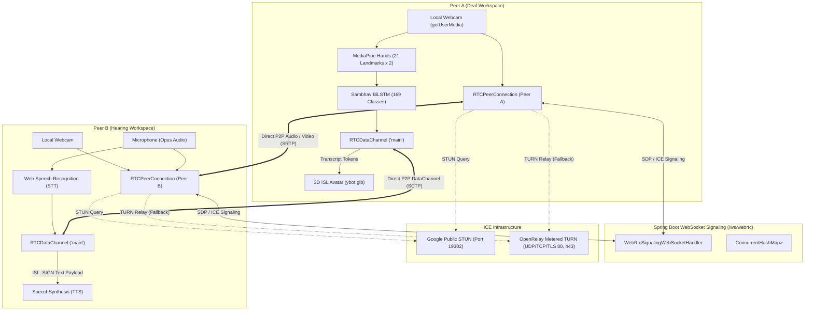
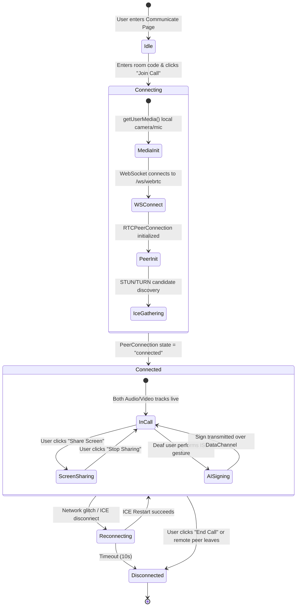

# SAMBHAV / SignBridge Communicate: Complete Video Call Architecture & Engineering Guide

This document is an exhaustive, production-grade reference manual on the **Communicate** video calling subsystem in SignBridge / SAMBHAV. It covers every protocol, lifecycle, state machine, fallback mechanism, data structure, and the bidirectional AI bridge (ISL $\leftrightarrow$ Speech) integrated into the live call.

---

## TABLE OF CONTENTS
1. [Executive Summary & Core Objectives](#1-executive-summary--core-objectives)
2. [High-Level Architecture & Component Topology](#2-high-level-architecture--component-topology)
3. [Protocols & Standards Used](#3-protocols--standards-used)
4. [Signaling Infrastructure (Spring Boot + WebSockets)](#4-signaling-infrastructure-spring-boot--websockets)
5. [NAT Traversal, STUN & TURN Infrastructure](#5-nat-traversal-stun--turn-infrastructure)
6. [PeerConnection Management & The Perfect Negotiation Pattern](#6-peerconnection-management--the-perfect-negotiation-pattern)
7. [Media Management (Camera, Microphone & Audio Switching)](#7-media-management-camera-microphone--audio-switching)
8. [Screen Sharing Architecture (Zero-Renegotiation Track Swapping)](#8-screen-sharing-architecture-zero-renegotiation-track-swapping)
9. [RTCDataChannel: Sub-10ms Sign & Transcript Bus](#9-rtcdatachannel-sub-10ms-sign--transcript-bus)
10. [Bidirectional AI Integration in the Video Call](#10-bidirectional-ai-integration-in-the-video-call)
    - 10.1 [Deaf User Workspace (Camera → MediaPipe → BiLSTM → DataChannel)](#101-deaf-user-workspace)
    - 10.2 [Hearing User Workspace (Mic → Web Speech STT → DataChannel → 3D Avatar)](#102-hearing-user-workspace)
11. [Call Lifecycle & State Machine](#11-call-lifecycle--state-machine)
12. [Error Recovery, Reconnection & Fallback Hierarchy](#12-error-recovery-reconnection--fallback-hierarchy)
13. [Code Directory & Key Files Reference](#13-code-directory--key-files-reference)
14. [Master Interview / Viva Q&A (Preparation for Any Question)](#14-master-interview--viva-qa)

---

## 1. EXECUTIVE SUMMARY & CORE OBJECTIVES

### The Problem
Traditional video calling solutions (Zoom, Google Meet, Microsoft Teams) transmit audio and video, but they provide **no native accessibility bridging** between deaf signers and hearing non-signers:
- Deaf users cannot understand spoken audio without delayed third-party human interpreters.
- Hearing users cannot understand Indian Sign Language (ISL) hand gestures.

### The SAMBHAV Solution
The **Communicate** module is a custom, accessible WebRTC video calling engine built directly into SignBridge. It delivers **real-time, bidirectional translation directly inside the video call pipeline**:

```text
[Deaf Participant]                                     [Hearing Participant]
    Signs ISL into camera                                  Speaks naturally into microphone
              ↓                                                        ↓
MediaPipe + BiLSTM Model                                 Web Speech Recognition (STT)
(126 Landmarks, 169 Classes)                                          ↓
              ↓                                             Transcripts sent over
Composed into text sentence                                    RTCDataChannel
              ↓                                                        ↓
Sent over RTCDataChannel                                 3D Avatar (ybot.glb) signs
              ↓                                          words to Deaf user in real-time
Synthesized to Speech (TTS)
spoken aloud to Hearing user
```

### Core Engineering Objectives
1. **Ultra-Low Latency Media:** Sub-150ms glass-to-glass latency for natural human conversation.
2. **Deterministic Data Transport:** Dedicated SCTP `RTCDataChannel` ensuring sub-10ms delivery of gesture tokens and chat transcripts.
3. **No Heavy Third-Party Cloud SDKs:** Avoids proprietary, vendor-locked, pay-per-minute services (e.g., Agora, Twilio Video, Zoom SDK). Built entirely on open web standards (`RTCPeerConnection`).
4. **Resilient NAT/Firewall Traversal:** Multi-tier STUN and fallback TURN/TURNS relay configuration.
5. **Collision-Free Signaling:** Strict implementation of the W3C **Perfect Negotiation Pattern** to prevent offer/answer "glare".

---

## 2. HIGH-LEVEL ARCHITECTURE & COMPONENT TOPOLOGY



---

## 3. PROTOCOLS & STANDARDS USED

| Layer | Protocol / Technology | Purpose in Communicate |
|---|---|---|
| **Signaling Transport** | **WebSocket (`ws://`, `wss://`)** | Bi-directional exchange of room states, SDP descriptors, and ICE candidates. |
| **Signaling Message Encoding** | **JSON** | Lightweight serialization of SDP offers, answers, and candidates. |
| **Media Transport** | **SRTP (Secure Real-Time Transport Protocol)** | Encrypted real-time streaming of audio and video tracks. |
| **Key Exchange & Security** | **DTLS (Datagram Transport Layer Security)** | End-to-end encryption for SRTP keys and data channels. |
| **Data Transport** | **SCTP (Stream Control Transmission Protocol)** | Multiplexed over DTLS for reliable, ordered/unordered `RTCDataChannel` messages. |
| **Video Codecs** | **VP8, VP9, H.264** | Hardware-accelerated adaptive video compression (640x480 @ 30 FPS). |
| **Audio Codecs** | **Opus (48 kHz)** | High-fidelity voice compression with dynamic bitrates (6–510 kbps). |
| **Session Description** | **SDP (Session Description Protocol)** | Describes media capabilities, codecs, ports, and bandwidth requirements. |
| **Connectivity & NAT** | **ICE (RFC 8445), STUN (RFC 5389), TURN (RFC 5766)** | Candidate gathering, hole punching, and relay fallback. |

---

## 4. SIGNALING INFRASTRUCTURE (SPRING BOOT + WEBSOCKETS)

WebRTC does not prescribe a signaling mechanism. SAMBHAV implements a dedicated **Spring Boot WebSocket handler**:

### Backend Implementation
- **File:** [`backend/.../webrtc/WebRtcSignalingWebSocketHandler.java`](file:///c:/Users/DELL/OneDrive/Desktop/proj/SignBridge%20ISL%20AI/backend/src/main/java/com/accessibleconnect/backend/communication/webrtc/WebRtcSignalingWebSocketHandler.java)
- **Endpoint:** `/ws/webrtc`
- **Room Storage:** `ConcurrentHashMap<String, Set<WebSocketSession>> rooms`

### Message Schema

| Message Type | Direction | Payload Example | Purpose |
|---|---|---|---|
| `join` | Client → Server | `{"type": "join", "roomId": "ROOM123", "role": "deaf"}` | Joins or creates a room session. |
| `joined` | Server → Client | `{"type": "joined", "roomId": "ROOM123", "isInitiator": true}` | Confirms entry and sets initiator status. |
| `peer-joined` | Server → Peer | `{"type": "peer-joined", "initiator": false}` | Alerts existing peer that the other user has entered. |
| `signal` | Client ↔ Client | `{"type": "signal", "data": {"type": "offer", "sdp": "..."}}` | Relays SDP offer, answer, or ICE candidate. |
| `app-message` | Client ↔ Client | `{"type": "app-message", "payload": {...}}` | Out-of-band signaling fallback if DataChannel is closed. |
| `ping` / `pong` | Client ↔ Server | `{"type": "ping"}` / `{"type": "pong", "timestamp": 17286...}` | 20-second heartbeat preventing cloud proxy idle disconnects. |
| `leave` / `peer-left`| Client ↔ Server | `{"type": "leave"}` | Cleans up session and alerts remaining peer. |

### Room Concurrency Control
```java
// Rooms are capped at 2 participants (1 Deaf + 1 Hearing user)
if (room.size() >= 2 && !room.contains(session)) {
    sendJson(session, Map.of("type", "room-full", "roomId", roomId));
    return;
}
```

---

## 5. NAT TRAVERSAL, STUN & TURN INFRASTRUCTURE

In real-world networks, $>80\%$ of client devices sit behind NAT routers or corporate firewalls that prevent direct IP connectivity.

### Configured ICE Servers
Located in [`frontend/src/WEBRTC/communication/peerConnection.ts`](file:///c:/Users/DELL/OneDrive/Desktop/proj/SignBridge%20ISL%20AI/frontend/src/WEBRTC/communication/peerConnection.ts):

```typescript
export const DEFAULT_ICE_SERVERS: RTCConfiguration = {
  iceServers: [
    // 1. Google Public STUN Cluster (Geographically distributed)
    { urls: 'stun:stun.l.google.com:19302' },
    { urls: 'stun:stun1.l.google.com:19302' },
    { urls: 'stun:stun2.l.google.com:19302' },
    { urls: 'stun:stun3.l.google.com:19302' },
    { urls: 'stun:stun4.l.google.com:19302' },
    
    // 2. Mozilla & Twilio Fallback STUN
    { urls: 'stun:stun.services.mozilla.com' },
    { urls: 'stun:global.stun.twilio.com:3478' },
    
    // 3. OpenRelay Metered TURN / TURNS Relays (Symmetric NAT / Strict Firewall Bypass)
    { urls: 'turn:openrelay.metered.ca:80', username: 'openrelay', credential: 'openrelay' },
    { urls: 'turn:openrelay.metered.ca:443', username: 'openrelay', credential: 'openrelay' },
    { urls: 'turn:openrelay.metered.ca:443?transport=tcp', username: 'openrelay', credential: 'openrelay' },
    { urls: 'turns:openrelay.metered.ca:443?transport=tcp', username: 'openrelay', credential: 'openrelay' },
    { urls: 'turns:openrelay.metered.ca:443', username: 'openrelay', credential: 'openrelay' },
  ],
  iceCandidatePoolSize: 10,
};
```

### How NAT Traversal Works:
1. **Host Candidates:** Client enumerates local IP addresses (`192.168.x.x`).
2. **Server Reflexive (srflx) Candidates:** Queries Google STUN servers to discover its public WAN IP and reflexive NAT port. Direct hole-punching succeeds for Full-Cone and Restricted-Cone NATs.
3. **Relay (relay) Candidates:** If both clients are behind **Symmetric NAT** (common in mobile 4G/5G carriers and corporate networks), direct hole punching fails. The connection transparently falls back to OpenRelay TURN servers over secure TLS/TCP port 443.

---

## 6. PEERCONNECTION MANAGEMENT & THE PERFECT NEGOTIATION PATTERN

### The "Glare" Problem
In standard WebRTC, if both peers simultaneously add a track or change settings, both send an SDP offer at the same time. This causes an **offer/answer collision ("glare")**, which crashes or deadlocks the signaling state.

### The Perfect Negotiation Solution
SAMBHAV implements the W3C **Perfect Negotiation Pattern**:
- One peer is designated as **Polite** (the Guest / non-creator).
- One peer is designated as **Impolite** (the Host / room creator).

```typescript
// Constructor in peerConnection.ts
this.isPolite = !isCreator; // Guest is polite, Host is impolite
```

#### Collision Resolution Logic:
```typescript
public async handleSignalOffer(sdp: RTCSessionDescriptionInit) {
  const offerCollision = this.makingOffer || this.pc.signalingState !== 'stable';
  
  if (offerCollision && !this.isPolite) {
    // Impolite peer drops the colliding incoming offer
    console.log('[WEBRTC] Impolite peer ignoring colliding offer');
    return;
  }
  
  if (offerCollision) {
    // Polite peer rolls back its own local offer and accepts the other peer's offer
    console.log('[WEBRTC] Polite peer rolling back colliding offer');
    await this.pc.setLocalDescription({ type: 'rollback' });
  }

  await this.pc.setRemoteDescription(new RTCSessionDescription(sdp));
  await this.drainPendingCandidates();
  
  const answer = await this.pc.createAnswer();
  await this.pc.setLocalDescription(answer);
  this.signaling.sendSignal({ type: 'answer', sdp: answer });
}
```

---

## 7. MEDIA MANAGEMENT (CAMERA, MICROPHONE & AUDIO SWITCHING)

Managed by [`WebRTCMediaManager`](file:///c:/Users/DELL/OneDrive/Desktop/proj/SignBridge%20ISL%20AI/frontend/src/WEBRTC/communication/mediaManager.ts):

### 1. Resilient Media Acquisition
Browser permissions can fail if audio and video are requested together (e.g. if a microphone is in use by another app). SAMBHAV uses an automatic 2-stage fallback:
1. **Unified Request:** `getUserMedia({ video: true, audio: { echoCancellation: true, noiseSuppression: true, autoGainControl: true } })`.
2. **Split Track Fallback:** If unified fails, it independently requests video, then audio, merging whatever tracks succeed.

### 2. Zero-Disruption Track Muting
Instead of tearing down the camera hardware or triggering SDP renegotiation:
- Audio Mute: `audioTrack.enabled = false` (transmits silence packets, keeping the stream active).
- Video Mute: `videoTrack.enabled = false` (transmits black frames, keeping the stream active).

### 3. Dynamic Device Switching
When a user switches their webcam or Bluetooth headset:
- Uses `RTCRtpSender.replaceTrack(newTrack)`.
- Replaces the underlying hardware feed without renegotiating the WebRTC connection or causing visual flicker.

---

## 8. SCREEN SHARING ARCHITECTURE (ZERO-RENEGOTIATION TRACK SWAPPING)

Managed by [`WebRTCScreenShareManager`](file:///c:/Users/DELL/OneDrive/Desktop/proj/SignBridge%20ISL%20AI/frontend/src/WEBRTC/communication/screenShareManager.ts):

### How it Works:
1. User clicks **Share Screen**.
2. Browser invokes `navigator.mediaDevices.getDisplayMedia({ video: true, audio: true })`.
3. The video sender’s current camera track is swapped for the screen track via `replaceVideoTrack`:
   ```typescript
   const videoSender = this.pc.getSenders().find(s => s.track?.kind === 'video');
   await videoSender.replaceTrack(screenTrack);
   ```
4. **Native OS End Detection:** When the user clicks the browser's native "Stop Sharing" overlay:
   ```typescript
   screenTrack.onended = () => {
     // Automatically restores the user's camera track
     this.replaceVideoTrack(this.mediaManager.getVideoTrack());
   };
   ```

---

## 9. RTCDATACHANNEL: SUB-10MS SIGN & TRANSCRIPT BUS

In addition to audio and video, SAMBHAV opens a bi-directional SCTP data channel named `'main'`:

```typescript
// Host creates data channel during initial offer
const dc = this.pc.createDataChannel('main');
this.wireDataChannel(dc);

// Guest receives data channel
this.pc.ondatachannel = (event) => {
  this.wireDataChannel(event.channel);
};
```

### DataChannel Message Types

| Message `type` | Payload | Trigger | Consumer Action |
|---|---|---|---|
| `ISL_SIGN` | `{ sign: 'HELLO', text: 'Hello, how are you?', timestamp: 1728... }` | Deaf user signs a gesture | Hearing user's browser renders subtitle card and activates Text-to-Speech (`window.speechSynthesis`). |
| `TRANSCRIPT` | `{ sender: 'speaker', text: 'Good morning', isFinal: true }` | Hearing user speaks into mic | Deaf user's browser updates caption feed and animates 3D Avatar. |
| `CHAT` | `{ sender: 'user', text: 'Message text...', time: '10:45 AM' }` | Typed message in composer | Appends to persistent chat sidebar. |
| `HAND_STATE`| `{ handsDetected: 2, isSigning: true }` | MediaPipe state change | Displays remote signing indicator pill on video feed. |

---

## 10. BIDIRECTIONAL AI INTEGRATION IN THE VIDEO CALL

### 10.1 Deaf User Workspace
**File:** [`frontend/src/components/communication/DeafUserWorkspace.tsx`](file:///c:/Users/DELL/OneDrive/Desktop/proj/SignBridge%20ISL%20AI/frontend/src/components/communication/DeafUserWorkspace.tsx)

1. **Local Camera Tap:** The local video element (`data-self-view="true"`) is passed to `useSambhavModel2()`.
2. **MediaPipe Tracking:** Evaluates 21 landmarks per hand at 30 FPS.
3. **2-Second Signing Accumulator:** Sustained signing collects a 60-frame vector.
4. **BiLSTM Forward Pass:** Model evaluates tensor `(1, 60, 126)` against 169 classes.
5. **Gating Validation:** Rejects noise if `confidence < 0.65` or `margin < 0.15`.
6. **Composition & Dispatch:** Verified signs enter [`ISLMessageComposer.tsx`](file:///c:/Users/DELL/OneDrive/Desktop/proj/SignBridge%20ISL%20AI/frontend/src/components/communication/ISLMessageComposer.tsx). On send, it broadcasts `{ type: 'ISL_SIGN', sign, text }` over the `RTCDataChannel`.

### 10.2 Hearing User Workspace
**File:** [`frontend/src/components/communication/HearingUserWorkspace.tsx`](file:///c:/Users/DELL/OneDrive/Desktop/proj/SignBridge%20ISL%20AI/frontend/src/components/communication/HearingUserWorkspace.tsx)

1. **Speech-to-Text (STT):** Runs continuous speech recognition on the hearing user’s microphone via `SpeechToTextService`.
2. **Transcript Broadcast:** Emits transcribed text over the `RTCDataChannel`.
3. **3D Avatar Rendering:** On the deaf user’s screen, incoming text tokens trigger [`ISLAvatarCanvas.tsx`](file:///c:/Users/DELL/OneDrive/Desktop/proj/SignBridge%20ISL%20AI/frontend/src/components/cultural/ISLAvatarCanvas.tsx), animating the `ybot.glb` skeletal model to spell or perform the sign.
4. **Text-to-Speech (TTS):** When incoming `ISL_SIGN` messages arrive from the deaf user, the hearing user's browser invokes `window.speechSynthesis.speak()` so the hearing user hears natural speech.

---

## 11. CALL LIFECYCLE & STATE MACHINE



---

## 12. ERROR RECOVERY, RECONNECTION & FALLBACK HIERARCHY

1. **Ice Connection Glitches:** If `iceConnectionState` enters `disconnected`, the polite peer automatically triggers `pc.restartIce()` via renegotiation.
2. **DataChannel Unavailable:** If the SCTP DataChannel fails to open (e.g. strict firewall), `WebRTCClient.sendAppData()` automatically diverts messages through the WebSocket signaling server (`app-message` relay), ensuring messages are never lost.
3. **Ghost Room Prevention:** Spring Boot heartbeat pings (`ping` / `pong` every 20 seconds) detect closed tabs or sudden mobile disconnects within 5 seconds, terminating zombie room sessions and freeing bandwidth.

---

## 13. CODE DIRECTORY & KEY FILES REFERENCE

| File Path | Role in Video Call Subsystem |
|---|---|
| [`backend/.../webrtc/WebRtcSignalingWebSocketHandler.java`](file:///c:/Users/DELL/OneDrive/Desktop/proj/SignBridge%20ISL%20AI/backend/src/main/java/com/accessibleconnect/backend/communication/webrtc/WebRtcSignalingWebSocketHandler.java) | Spring Boot WebSocket signaling broker managing rooms, SDP relay, and heartbeats. |
| [`frontend/src/WEBRTC/communication/signaling.ts`](file:///c:/Users/DELL/OneDrive/Desktop/proj/SignBridge%20ISL%20AI/frontend/src/WEBRTC/communication/signaling.ts) | Client-side WebSocket connection manager handling room joins, offers, answers, and pings. |
| [`frontend/src/WEBRTC/communication/peerConnection.ts`](file:///c:/Users/DELL/OneDrive/Desktop/proj/SignBridge%20ISL%20AI/frontend/src/WEBRTC/communication/peerConnection.ts) | Core WebRTC manager: STUN/TURN, track management, DataChannel, and Perfect Negotiation. |
| [`frontend/src/WEBRTC/communication/mediaManager.ts`](file:///c:/Users/DELL/OneDrive/Desktop/proj/SignBridge%20ISL%20AI/frontend/src/WEBRTC/communication/mediaManager.ts) | Camera/mic capture, fallback track allocation, device enumeration, and mute toggles. |
| [`frontend/src/WEBRTC/communication/screenShareManager.ts`](file:///c:/Users/DELL/OneDrive/Desktop/proj/SignBridge%20ISL%20AI/frontend/src/WEBRTC/communication/screenShareManager.ts) | Screen capture and dynamic track replacement via `replaceTrack`. |
| [`frontend/src/WEBRTC/communication/WebRTCClient.ts`](file:///c:/Users/DELL/OneDrive/Desktop/proj/SignBridge%20ISL%20AI/frontend/src/WEBRTC/communication/WebRTCClient.ts) | High-level orchestrator connecting signaling, peer connection, and media managers. |
| [`frontend/src/WEBRTC/hooks/useWebRTC.ts`](file:///c:/Users/DELL/OneDrive/Desktop/proj/SignBridge%20ISL%20AI/frontend/src/WEBRTC/hooks/useWebRTC.ts) | React hook wrapping the WebRTC client with reactive state (streams, status, devices). |
| [`frontend/src/pages/OnlineSessionPage.tsx`](file:///c:/Users/DELL/OneDrive/Desktop/proj/SignBridge%20ISL%20AI/frontend/src/pages/OnlineSessionPage.tsx) | Main Communicate page hosting role detection and workspace routing. |
| [`frontend/src/components/communication/DeafUserWorkspace.tsx`](file:///c:/Users/DELL/OneDrive/Desktop/proj/SignBridge%20ISL%20AI/frontend/src/components/communication/DeafUserWorkspace.tsx) | Video call layout for deaf users: local camera AI tracking, ISL composer, and 3D Avatar. |
| [`frontend/src/components/communication/HearingUserWorkspace.tsx`](file:///c:/Users/DELL/OneDrive/Desktop/proj/SignBridge%20ISL%20AI/frontend/src/components/communication/HearingUserWorkspace.tsx) | Video call layout for hearing users: speech recognition (STT), subtitles, and TTS audio. |

---

## 14. MASTER INTERVIEW / VIVA Q&A (PREPARATION FOR ANY QUESTION)

### Q1: Why did you build custom WebRTC instead of using an existing SDK like Agora or Twilio?
**Answer:**
1. **Cost & Vendor Lock-In:** Third-party SDKs charge per-user, per-minute fees and enforce proprietary binary blobs.
2. **Direct Frame Access:** SAMBHAV requires raw access to the webcam stream (`HTMLVideoElement` and `MediaStreamTrack`) to run real-time landmark extraction with MediaPipe and the BiLSTM neural network. Third-party SDKs often encapsulate video rendering in canvas sandboxes, adding latency or obstructing local AI pipelines.
3. **Sub-10ms Custom Data Transport:** With native `RTCDataChannel`, we control the exact serialization and priority of gesture events (`ISL_SIGN`) with zero cloud overhead.

### Q2: What is the "WebRTC Glare" problem, and how did you resolve it?
**Answer:**
Glare occurs when both peers simultaneously initiate an SDP offer (for instance, if both users turn on screen share or change devices at the exact same moment). In standard WebRTC, this causes an offer collision and crashes the signaling state.  
We resolved this using the W3C **Perfect Negotiation Pattern**:
- The room host is designated as **impolite**; the guest is designated as **polite**.
- When an offer collision occurs, the polite peer automatically executes a rollback (`pc.setLocalDescription({ type: 'rollback' })`) and accepts the incoming offer, while the impolite peer ignores the colliding offer. This guarantees deterministic convergence.

### Q3: How do you traverse symmetric NATs and enterprise firewalls?
**Answer:**
Direct peer-to-peer hole punching works with STUN for moderate NATs, but fails when both peers are behind Symmetric NATs (common on cellular data networks).  
We configured **OpenRelay Metered TURN / TURNS** servers over UDP, TCP (`port 80` and `port 443`), and encrypted TLS (`turns:...:443`). Because port 443 TCP/TLS mimics standard HTTPS traffic, firewall packet inspection allows the media relay stream without blocking.

### Q4: How is screen sharing handled without freezing or reconnecting the call?
**Answer:**
We do not renegotiate the SDP or recreate the connection. We use `RTCRtpSender.replaceTrack()`. When the user starts screen sharing via `getDisplayMedia()`, the video sender replaces the existing camera `MediaStreamTrack` with the screen capture track instantly. When screen sharing ends, `track.onended` triggers and restores the camera track seamlessly.

### Q5: How do deaf and hearing users communicate in the same call?
**Answer:**
- **Deaf $\to$ Hearing:** The deaf user signs into their webcam. Local MediaPipe + Sambhav BiLSTM recognizes the sign and sends an `ISL_SIGN` JSON payload over the `RTCDataChannel`. The hearing user's browser displays real-time subtitles and triggers `window.speechSynthesis` (Text-to-Speech) to speak the sign aloud.
- **Hearing $\to$ Deaf:** The hearing user speaks into their mic. Web Speech STT transcribes the speech into text tokens sent over the `RTCDataChannel`. The deaf user's browser displays captions and feeds the tokens into the 3D Avatar (`ybot.glb`), which performs the sign gestures visually.

### Q6: What video and audio codecs are negotiated?
**Answer:**
- **Video:** VP8 and H.264 (Baseline/Constrained Baseline) for broad cross-browser compatibility across Chrome, Firefox, Safari, and mobile browsers.
- **Audio:** Opus codec sampled at 48 kHz with built-in Echo Cancellation, Noise Suppression, and Auto Gain Control enabled via WebRTC constraints.

### Q7: What happens if the DataChannel fails to connect?
**Answer:**
Our `WebRTCClient` implements an out-of-band fallback: if the DataChannel is not in the `'open'` state, application messages are automatically routed through the Spring Boot WebSocket signaling connection via the `app-message` message type. Communication is never broken.
